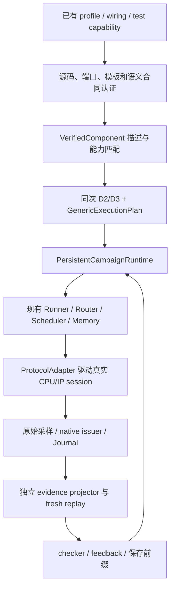

# 通用 CPU/IP 数据流运行框架设计

日期：2026-10-26。性质：交给 DS 实现的设计合同，**尚未实现或验收**。

配套：[DS 任务计划](../plans/2026-10-26-generic-runtime-ds-implementation-plan.md)、[执行交接](../../handover/DS_GENERIC_RUNTIME_TASK.md)。已有阶段状态仍由 [CURRENT_PROGRESS](../../CURRENT_PROGRESS.md) 和各冻结报告定义。

## 1. 目标、范围和选择

目标：新增同协议、同受支持语义的组件时，只补源码/profile/语义合同及相应验证，不修改通用 Runner、Router、路径编译、变异器或证据主循环中的组件名称分支。已有独立真实 harness、局部时钟、持久内存、完整前缀 replay 继续复用。

选择增量迁移：现有可信源读者、native issuer、协议执行和 F2/F4/F6 证据消费者保留，先在其外建立统一的能力、执行计划和适配边界，再逐路径迁移。其余两条路线不采用：仅把具名工厂换成注册表仍会把耦合藏在工厂里；重写整个运行时会丢失现有源码与证据基础。

完整目标覆盖六 CPU（Ibex/CVA6/CV32E40P/BOOM/CVW/VexiiRiscv）、四 IP 系列（OpenTitan/PULP/ZipCPU/Caliptra）在声明的协议/ISA/事件子集上的 F1–F6 持久 fuzz、checker 和 fresh replay。矩阵按具体 profile/协议/语义/路径定级；一个系列有一个固定实例通过，不等于该系列全部外设通过。

首版不推断任意 RTL 的寄存器副作用，不加入物理 SoC bridge，不要求所有 CPU 具备相同 IRQ/retirement 观察能力。未知或未证明能力明确拒绝/降级，不从协议名称、最终 RAM 相等或组件别名推断。

## 2. 当前接缝：复用与替换

| 现有模块 | 本设计的处理 |
|---|---|
| `composition/component_profile.py`、`local_harness/plan.py` | 继续认证源码、elaboration、端口和 profile；不重复实现 source crawler |
| `local_harness/template_contracts.py`、`runtime_renderer.py`、各 session | 继续执行真实协议；新增接口适配层，逐种 ABI 接入 |
| `scenario/runner.py`、Router/Scheduler、`memory.py`、`memory_service.py`、`ledger.py` | 继续拥有调度、内存和事务；不创建第二套内存/ledger |
| `scenario/runtime_path_contract.py`、`runtime_edge_index.py` | 继续做 typed 图、拓扑和 DMA route 校验；不另造路径图 |
| `scenario/dma_route_admission.py` | 保留协议中立 route/beat 匹配；把 target 选择委托给经认证的 provider binding |
| `scenario/dma_intent_topology_binding.py` | 现有 exact session/component 分支留作 legacy；新路径改由能力匹配和 provider binding 进入 |
| `integration/compiled_storage_producer.py` | 现有 GPIO/APB 两行继续兼容；新源合同通过统一 binding 选择，不能退回具名工厂 |
| `integration/generated_storage_consumer.py`、native issuer | 保留实际 APB/raw/token 边界；普通 JSON 不可替代 opaque token |
| `integration/compiled_f2* / compiled_f4* / compiled_f6*` | 先作为版本化 flow kernel，逐个接入统一生命周期；不合并所有源码为一个万能 executor |
| RFuzz transport、EventJournal、保存态 verifier | 传输/存储复用，证据语义仍按不同 flow 独立验证 |

legacy 路径可继续重放其旧 schema；新 generic 路径缺能力时直接拒绝。禁止“generic 失败后自动调用 make_ibex_* / 某个旧 family”以获得通过。

## 3. 分层与职责



### 3.1 五个正交维度

1. **Transport**：协议、版本、variant、位宽、地址单位、BE、outstanding、wait/error、completion、reset cancellation。
2. **Semantics**：稳定 storage、W1C/W1S、FIFO push/pop、命令触发、DMA CSR、IRQ source、指令源、CPU ABI。协议相同不代表语义相同。
3. **Evidence**：哪些原始采样、版本/来源、IRQ take、retirement、effect 和 reset 能被证明；observed 不自动升级为 consumed。
4. **Execution**：持久 session、动作接纳、预算、终止、process drain、异常收尾、prefix replay。
5. **Identity**：精确源码、profile/参数、生成文件、工具、可执行文件、原/新进程、case/reset/transaction。

组件名称和实例 ID 是身份字段，只用于 join、路由、显示和报告；不得参与 adapter、kernel 或语义行为选择。协议/语义能力 ID 必须来自认证结果，不接受请求自行声称。

### 3.2 建议新增文件（单一职责）

以下为 DS 将创建的路径，目前不表示模块已经存在。

```text
src/myfuzz/runtime/
  __init__.py
  contracts.py          描述对象、执行选择、计划和拒绝类型
  registry.py           内置 adapter/kernel 注册表与唯一匹配
  preparation.py        一次D2/D3生成及仅进程内的PreparationContext
  admission.py          真实runtime artifact认证到 VerifiedComponent
  compiler.py           同次 D2/D3 到执行计划；路径、来源和断言能力检查
  binding.py            descriptor 与真实 session 的进程内绑定
  engine.py             持久生命周期，委托现有 Runner/ScenarioSession
  campaign.py           统一 RFuzz 入口与逐例记录
  adapters/
    contracts.py        ProtocolAdapter / TargetProvider / CpuDriver 接口
    apb3_storage.py     首个 storage target adapter
    obi_cpu.py          现有 OBI CPU 接口适配
    wishbone.py         Wishbone target/master 子集（后续任务）
    ahb_lite.py         AHB-Lite 子集（后续任务）
    axil.py             AXI4-Lite 子集（后续任务）
    axi4.py             已声明 full/reduced AXI 形态分别接入（后续任务）
    tlul.py             TL-UL target 子集（后续任务）
    native_cpu.py       native / Wishbone CPU 的已证明边界（后续任务）
    tilelink.py         BOOM 已证明 uncached A/D；coherent 单列（后续任务）
  semantics/
    contracts.py       operation/region/side-effect/证据义务
    storage.py         稳定寄存器语义合同
    dma.py             DMA control/master 与传输义务（后续任务）
    irq.py             电平/脉冲、take/ISR 能力（后续任务）
    cpu_abi.py         指令编码、启动、陷入、返回 ABI（后续任务）
  flows/
    storage.py         F2/F4 首切片，复用旧编译/证据消费者
    dma.py             F6 迁移 kernel（后续任务）
  evidence/
    contracts.py       edge claim、原始引用、状态与 scope
    saved.py           保存态独立检查编排；调用经过复审的原始 projector
```

后续任务文件只在被实现时创建，禁止先铺一批空模块或 `NotImplementedError` 框架。现有模块不因加入这个目录而批量移动。

## 4. 数据合同与 API

### 4.1 唯一身份规则

复用 `TransactionKey(execution_id, testcase_id, source_component, source_epoch, channel_id, source_sequence)`，不能改成 address 或 case_id 索引。MemoryService 局部序号不跨 owner 合并；共享 RAM 的跨服务 join 依靠真实 byte-version/writer/generation 和原始事件。

`contract_sha256`、`source_sha256`、`artifact_sha256`、`build_sha256`、`plan_sha256`、`capture_sha256` 分别表意，不创建含混的“万能 identity”。source_sha256取已核验source closure map（含Git pin、实际文件SHA、参数/elaboration声明）的canonical SHA-256，不把Git commit字符串截断成SHA-256；artifact_sha256使用通过既有artifact校验后的runtime_document.artifact_digest及其生成六文件闭包关联。

实例改名会改变身份摘要；比较的是相同的选择结果和经声明映射的行为，不要求改名后的 digest 不变。

### 4.2 模块接口（固定给 DS）

这些是设计签名；不是可绕过原生权威的构造 API。

```python
# runtime/contracts.py
@dataclass(frozen=True, slots=True)
class CapabilityRequirement:
    role: str                    # cpu / target / dma_master / irq_source
    endpoint_id: str             # 明确选择一个端点，不能从多端点猜选
    protocol: tuple[str, str]    # 本仓库APB3使用 ('apb', '3')
    template: tuple[str, str, str] # id, version, variant
    semantic_kind: str           # 如 storage.rw.v1
    operations: tuple[str, ...]  # read / write
    data_width: int
    address_width: int
    max_outstanding: int
    completion_kind: str
    byte_enable_required: bool
    address_units: str           # byte / word
    evidence_obligations: tuple[str, ...]

@dataclass(frozen=True, slots=True)
class VerifiedComponent:
    instance_id: str
    source_sha256: str
    profile_sha256: str
    artifact_sha256: str
    semantic_contract_sha256: str
    descriptor_bytes: bytes      # canonical immutable documentary descriptor

@dataclass(frozen=True, slots=True)
class AdapterSelection:
    adapter_id: str
    adapter_version: str
    implementation_sha256: str
    component_artifact_sha256: str
    semantic_contract_sha256: str

@dataclass(frozen=True, slots=True)
class GenericExecutionPlan:
    schema_version: str          # generic_execution_plan.v1
    document_bytes: bytes        # canonical static plan; detached copies only
    identity_sha256: str

class GenericRuntimeRefused(ValueError):
    # attributes: code: str, pointer: str, detail: str
    pass

# runtime/preparation.py
create_preparation(*, base_dir: Path, compose_path: Path,
                   capability_paths: tuple[Path, ...], supplement_path: Path,
                   generated_dir: Path, flow_ids: tuple[str, ...]
                   ) -> PreparationContext

# runtime/admission.py
verify_component(artifact: LocalRuntimeArtifact, *,
                 preparation: PreparationContext, base_dir: Path
                 ) -> VerifiedComponent

# runtime/registry.py
select_adapter(component: VerifiedComponent,
               requirement: CapabilityRequirement, *,
               preparation: PreparationContext) -> AdapterSelection

# runtime/compiler.py
compile_execution_plan(preparation: PreparationContext, *,
                       components: tuple[VerifiedComponent, ...],
                       selections: tuple[AdapterSelection, ...],
                       requirements: tuple[CapabilityRequirement, ...]
                       ) -> GenericExecutionPlan

# runtime/binding.py
bind_execution_plan(plan: GenericExecutionPlan, *,
                    preparation: PreparationContext,
                    sessions: Mapping[str, object],
                    prepared_paths: PreparedRuntimePathContract,
                    runner: ScenarioRunner) -> BoundExecutionPlan
```

`BoundExecutionPlan` 是仅进程内的绑定句柄：私有保存真实 runner/session/adapter/native issuer 引用与已认证 topology，公开 `plan_sha256`、`assert_current()`、`close()`。无 `from_json`、无配置指定 factory/import。重新加载 JSON 只能得到待认证声明，不能恢复该句柄或 live authority。构造和每次 effect 前都核对真实对象及原生发行边界，不能仅信任 dataclass 的字符串摘要。

`verify_component`读取真实 `LocalRuntimeArtifact.plan`、`runtime_document`和生成文件闭包，确认artifact是preparation.artifacts中同一个对象。storage选择从已认证 `artifact.runtime_document["storage_observation"]["selection"]` 取显式 `{contract_id, register}`，与 `storage_probe_selection(artifact.plan)` 逐项相等，并独立验证observation["source_contract"]。复用 `compiled_storage_producer._generic_apb_document` 已有的schema/scope/sample_group、三项authority=false、native trace、source reader和generated-expression交叉检查；不能从profile或寄存器名称猜选，也不能重新渲染另一份artifact冒充所传对象。`LocalHarnessPlan`只有source/port事实，不足以提供artifact摘要或storage选择。

`verify_component` 依赖代码拥有的信任注册表；调用者不能注入 verifier/factory/callback。G1/G2 软件测试可用明确的私有 fake fixture，生产入口不接受测试注册项。

### 4.3 同次准备的实际载体与装配顺序

`PreparationContext`由代码拥有的 `create_preparation` 私有发行，不接受JSON恢复或公开任意构造。它拥有：

- `artifacts: Mapping[str, LocalRuntimeArtifact]`：现有load_generated_artifacts的真实映射，按instance_id索引；不是tuple。
- `compiled_inputs`：本次生成的真实request/compiled/ownership/physical_port_map对象及其sealed摘要。
- 本次唯一typed graph与后续绑定实际runner的prepared_paths对象；graph第一次按本次D3物化并登记，handoff后不再创建另一份“内容相同”的图。
- 私有generation stamp及所发行的VerifiedComponent/selection/plan对象成员记录；stamp只用于本进程来源关联，不写入静态plan hash。
- 输入文件、生成六类文件和tool的独立摘要。可导出documentary快照；导出的preparation_id或hash不能替代对象成员关系。

select_adapter显式接收preparation，并将selection登记在同一context。compiler只接受本context认证/选择的对象，并将发出的plan登记在该context；bind只接受该context发出的同一plan和登记的实际prepared graph。成员关系必须比较实际对象身份而不是dataclass值相等；context.close后撤销其登记和live句柄，并释放引用。另一次create_preparation即使内容hash相同，也不能混用其artifact/selection/plan/graph。artifact内可变dict与生成文件在编译/绑定边界按sealed摘要和原issuer规则复核。

当前 `prepare_compiled_execution_files`返回 `(artifacts, inputs, support)` 且一次只接收一个flow。实现时抽取它内部可复用的生成/编译阶段，**一次生成D2、一次构建request/ownership、一次compile_paths**，再对同一artifacts/inputs分别assessment F2/F4；旧single-flow API作为兼容wrapper保留。不得调用旧函数两次、再把两个结果贴成“同次准备”。capability、supplement、fixed ownership与physical map校验全部保留。

静态准备不需要真实runner，也不得要求runtime prepared graph先存在。顺序固定：显式输入 → create_preparation → artifact认证/能力选择 → static execution plan → 创建共享PersistentMemory → 创建所需target/provider sessions和Router → 将该memory/router传入CPU session构造 → 创建runner → 从本context的D3唯一物化并绑定prepared graph → bind_execution_plan → ScenarioSession.begin → case执行。session构造若会启动native子进程，只能在static拒绝门已通过后调用；之后任何绑定失败都必须回收已启动子进程。

fresh先从保存的原始输入重新create_preparation和绑定新runner，再比较静态计划；不能从旧JSON重造旧live handle。原进程stamp与fresh stamp不同是正常的，不是放宽artifact或plan匹配。

### 4.4 静态 descriptor 的闭合形状与匹配

`descriptor_bytes` 的schema为 `verified_component_descriptor.v1`，顶层恰为：`schema_version, instance_id, source_sha256, profile_sha256, artifact_sha256, semantic_contract_sha256, source_verifier, endpoints`。所有摘要字段的字符串必须与VerifiedComponent对应字段相等。

协议token沿用现有tuple，不建立APB3→`apb3/1`的隐式别名。界面可显示APB3，但descriptor/匹配/plan保留 `apb/3` 和原始template identity；其他协议同样沿用已认证原始token。

`source_verifier`恰为 `id, version, implementation_sha256`；每个endpoint恰为 `endpoint_id, role, protocol, template, semantic_kind, operations, data_width, address_width, address_units, max_outstanding, completion_kind, byte_enable, evidence_capabilities`。protocol长度2、template长度3；operation/evidence列表唯一并按字典序规范化；int字段拒绝bool；JSON拒绝重复key、NaN、Infinity、额外字段。所有嵌套字段通过canonical bytes封存，不保留调用者可变dict。

匹配条件：endpoint_id/role/protocol/template/semantic_kind/width/address_units/completion精确相等，所需operation与evidence必须为已认证集合的子集，required.max_outstanding≤supported.max_outstanding；需要BE时提供者须证明支持BE。不能用更宽数据截断、名称相似或协议family相同来代替。地址对齐、alias、窗口与副作用由具体semantic contract和计划进一步严格检查。

AdapterSelection记录的是代码拥有的实现选择，不能作为source或native token；binding重新从真实artifact/source验证并核对每一项，拒绝手工构造对象绕过认证。

### 4.5 Adapter 接口

`adapters/contracts.py` 定义受信实现需要遵循的职责：

- `ProtocolAdapter.bind(component, session, selection) -> BoundProtocolAdapter`：认证实际 artifact、driver ABI、binary/READY 和接口合同，成功后才有执行句柄。
- `BoundProtocolAdapter.assert_current() -> None`：无全树重扫的稳定性校验；原生 issuer 保留每次发行所需的检查。
- `TargetProvider.prepare(key, request) -> PreparedTargetOperation`：只检查 route、权限、语义和预算，不推进 IP；同 key 同 payload 返回同一 pending 记录，同 key 不同 payload 拒绝。
- `TargetProvider.advance(operation, budget) -> ProviderProgress`：通过现有 session/Runner 推进真实协议，返回 pending/completed/refused/faulted/uncertain_effect；不创建宿主模拟的寄存器效果。
- `TargetProvider.complete(operation) -> EffectEvidence`：关联原始 native 采样和实际 effect/token；没有原生权威时只能给观察或 missing，不能签发 consumption。
- `CpuDriver` 提供经过认证的程序槽、数据响应、IRQ 输入和局部 step 映射；按 ABI 能力选择，不由 CPU 名称选择固件。

`TargetProvider.prepare`的request为下述TargetRequest；其字段复用现有typed transaction/payload的解释与验证。新增返回合同统一定义在 `adapters/contracts.py` 与 `evidence/contracts.py`：

| 类型 | 固定字段及含义 |
|---|---|
| `TargetRequest` | `path_id: str, source_ref: EvidenceRef, address: int, operation: str, write_data: Optional[int], byte_enable: int, size_bytes: int`；地址为经过源协议单位校验的byte地址，operation只允许read/write，read的write_data为None；source_ref须join当前runner中该key的真实源接纳事件，不接受裸地址写入 |
| `EvidenceRef` | `component: str, event_id: int, kind: str`，与对应现有原始事件库关联；身份字段在原始事件校验中重建 |
| `PreparedTargetOperation` | provider私有发行的不可序列化句柄，公开 `key: TransactionKey, operation_id: str, request_sha256: str, route_sha256: str, binding_sha256: str`；实际ledger entry与绑定对象由provider私有保存 |
| `ProviderProgress` | `key, status, advanced_ticks, response_bytes, raw_refs, reason_code`；ticks为非负严格int，response为canonical原生响应payload bytes或None，raw_refs为EvidenceRef tuple，status限pending/completed/refused/faulted/uncertain_effect |
| `EffectEvidence` | `key, status, scope, binding_sha256, semantic_contract_sha256, source_refs, native_refs, destination_refs, obligation_results`；refs为不可变EvidenceRef tuple，obligation_results为 `(name, status)` tuple，status使用§5.4四态 |

operation_id由完整key、request、route、binding的canonical摘要产生；同key同payload已完成时返回既有结果，不重发写事务或再次消费native token。手工构造相同字段不获得provider中的操作记录或native权威。接口中的Python Protocol只约束结构，不能代替源码和native认证。

### 4.6 语义合同

semantic contract 闭合字段：`schema_version, kind, source, endpoint, decode, operations, reset, side_effects, observations, issuer_contract`。

- `source`：pin、文件/参数/elaboration 闭包以及代码拥有的 verifier 版本。
- `decode`：真实地址宽度、单位、alignment、alias predicate。对真实 alias 不凭“等于某 offset”错误拒绝，也不扩大到其他寄存器。
- `operations`：每项明确宽度、read/write mask、BE、访问前提和可变字段。
- `reset`：源声明与是否有实际波形观察分别记录；case begin 不构成 reset。
- `side_effects`：storage、W1C、FIFO-pop、command-start 等显式区分；缺失语义不当成 storage。
- `observations / issuer_contract`：实际可观察字段、来源引用、可发行证据及其 scope。

首切片仅使用现有源码登记的 `TIMER0_CTRL` 与 SPI `SPICMD` storage 行；它们不代表整个 timer/SPI 的所有寄存器都具有 storage 语义。现有 source reader 的固定合同继续核验，不能把注册表中的声明直接当作已验证事实。真正新增的第二源码合同接入验收由 G7 负责。

## 5. 编译、执行和证据不变量

### 5.1 编译

1. 输入继续为已有 compose/request/profile、path wiring 与 test capability，不发明第二套 SoC 描述。
2. D2 artifact、D3 selected graph/path/source/constraints/seeds/assertions 必须由同一个PreparationContext拥有；编译时核对摘要、owner和对象成员关系，运行时只接受该context登记的实际prepared对象。
3. code-owned flow kernel从本次D3推导其必需capability/evidence obligations；compiler必须重新推导并逐项对照传入requirements/selections，拒绝删减断言、证据义务或kernel替换。对每条选择路径再唯一匹配adapter和flow kernel；0个匹配拒绝，多个匹配拒绝，不使用注册顺序或优先级猜选。
4. 结果保存组件和端点绑定、源/Bound Input 归属、mutation layout、路径边、ABI、memory、clock/reset/IRQ、断言、终止和证据义务。
5. 编译成功仅是 static_supported；native、source-consumed 或系统级别都须独立实际证据。

### 5.2 持久生命周期

`CREATED → PREPARED → RUNNING → QUIESCING → CLOSED`；运行异常进入 `FAULTED` 后只允许收尾/保存。状态转换必须显式检查，所有 child process 均有终态与回收记录。

`PersistentCampaignRuntime` 持有一个 `ScenarioRunner`、一个现有 `ScenarioSession` 和一组实际 CPU/IP sessions；提供 `start() / submit(case) / finish() / abort(reason)`。同一 run 的 case 之间不重新 build、启动、reset 或替换 RAM；初始化与 bootstrap 只做一次。`submit` 仍通过现有 source_action/prerequisite gate，并逐例记录真实 source/case receipt。

kernel接口固定为 `requirements(d3_path) -> tuple[CapabilityRequirement, ...]`、`prepare(bound_plan, path_id) -> FlowContext`、`lower(context, case) -> OnlineCase`、`capture(context, receipt) -> tuple[EffectEvidence, ...]`、`feedback(context, claims) -> tuple[int, ...]`。registry按flow_id和已认证语义/CPU ABI唯一选择kernel。FlowContext只持有既有binding/plan/source布局引用，不拥有新session/runner；prepare/lower不得驱动RTL，实际提交仍由现有ScenarioSession推进。

case可选择计划内的F2或F4路径；两个kernel共用binding和session，不能为混合序列另开进程。directed输入schema为 `generic_case_sequence.v1`，顶层恰为 `schema_version, plan_sha256, cases`；每项case恰为 `testcase_id, path_id, source_id, raw_records_hex`，按所选旧flow的wire decoder处理，raw列表不裁剪。计划版本、路径和source不匹配在接纳前拒绝。RFuzz首版一个campaign固定一个已编译flow/layout，用已有8-byte record和source映射；混合F2/F4首先由directed序列验证。以后如需单一wire流混合选择不同layout，单独定义版本化外层分派合同，不占用旧record位或改变旧wire解释。

每例仅重置 case-local scoreboard，不清除跨例 memory、ledger、IRQ/pending 或物理状态。reset 只能是经声明接纳的动作，并开启对应 epoch、撤销旧 live grant、记录取消/未决操作。

新 generic 配置缺能力时拒绝，不静默变为 `fresh_genomes`。旧配置仍可明确选择旧模式，报告不得把两者混算。

### 5.3 effect 边界与错误

允许 config/admission 在 native 启动前拒绝；route/operation policy 必须在 target effect 前拒绝。真实 DUT ERR 另记为硬件响应，不把宿主 refusal 伪装成 RTL ERR。开始推进后出现断连/超时、无法排除效果时保留 uncertain_effect 和 pending keys，停止当前 run；不能重试同一写效果或编造 drain。进程崩溃后的恢复走完整 fresh prefix，而不是对旧外设假设 exactly-once。

参考拒绝码：`generic-source-unverified`、`generic-semantic-unsupported`、`generic-template-mismatch`、`generic-adapter-missing`、`generic-adapter-ambiguous`、`generic-binding-drift`、`generic-plan-mismatch`、`generic-route-refused`、`generic-evidence-missing`。每个都有 JSON pointer 和不含敏感值的 detail；不能 catch Exception 后改记 missing 掩盖 contradiction。

### 5.4 证据

每个 edge claim 保存 `status, scope, transaction_key, source_refs, native_refs, destination_refs, obligation_results`；状态为 certified/missing/contradicted/unsupported。组合优先级为 contradicted → missing → unsupported → certified，不使用“最后值相等”覆盖中途违例；unsupported 是未提供所需证明能力，不能制造已执行事实。

scope由已认证provider/kernel的能力与实际满足的义务推导，不接受caller任意填写“retirement”等字符串升级结论。兼容旧schema时仅在新报告中显式映射旧结果的scope和四态，不重写旧报告或提高其原等级。

保持三层：物理协议采样、组件语义效果、跨组件来源/消费。IRQ pin 高、native take、ISR 入口、退休、MRET/返回以及 RAM writeback 分别证明；不能合并成一个 irq_success。

Journal event_id 证明采集顺序，不证明跨组件硬件总因果。实际因果用完整 key、同 producer/step、源版本和原始握手；原始 journal 的递增和缺口规则仍按既有合同检查。

native opaque token 的发行/单次消费保持在原 native authority 内。通用 binding 只路由它们，不在 Python/JSON 中克隆、替代或升级 authority。通用层不做 exact session class whitelist；适配器内部为认证实际 ABI/issuer 而保留的严格类型/代码身份检查不能改成 hasattr。

保存态 verifier 从原始输入/源锚点/样本独立重构，不信任 live claim；live 和 saved 可共享 schema/解析规则，不能仅重用同一个结论函数相互自证。fresh 必须新进程，重放相同初始化和完整前缀；只对明确列出的 PID/nonce/execution身份做保持引用一致性的重命名，不归一化 payload、源 byte-version、reset 顺序或缺失事件。

## 6. 性能设计

- 启动时做 source/tool/contract/build 完整认证；case 热路径采用已编译 immutable plan、局部状态和 issuer 必需校验。
- 不在每个 tick 全树 hash、全历史重扫、全 trace 深拷贝或重新编译路径。保存增量原始日志和索引，单写出队列有界；满时施加 backpressure，不丢证据。
- 先复用现有紧凑 transport、EventJournal 和构建缓存，再按协议合同设计 batching；batch 不能跨过IRQ/等待条件或改变采样时序。
- 分开报告 build/init、admission、RTL/local tick、route、checker、feedback、日志、finalization、fresh 成本；useful cases/s、certified chains/s 与覆盖收益分别列出。
- 5×门按相同硬件、输入、协议范围、预算、checker、日志和replay义务做配对比较；不以关闭观测/重放换取数字。

## 7. 纵向迁移与完成定义

| 里程碑 | 交付 | 能宣称什么 |
|---|---|---|
| G0 | 工作树和源码/输入基线 | 有可恢复基线 |
| G1–G2 | 合同、受信认证与唯一选择 | 软件能力匹配，不含native |
| G3–G5 | APB storage adapter、同次计划、持久执行 | 两个已登记source合同经同一generic入口执行 |
| G6 | 首切片真实positive/refusal/fresh、独立原始审计 | 声明范围内generic APB storage纵向通过 |
| G7 | 新source的新同协议target，仅补profile/语义合同 | 首个新增组件不改通用运行时的接入证明 |
| G8 | CPU协议/ABI、持久反馈、IRQ/语义扩展 | 各新协议/语义逐行定级，不能一并标总门完成 |
| G9 | F6接入及完整真实正/负/fresh | 所声明DMA/IRQ/ISR合同通过；当前F6失败先闭合 |
| G10 | 矩阵、P7-E、P8、性能和系统审计 | 满足原计划逐项退出条件后才宣称完整系统 |

G1–G6 是第一份可独立审阅的子项目。G7–G10 每个协议/语义仍拆成 source proof、软件拒绝、真实正/负例、持久会话、完整fresh、独立审计；不允许在同一任务中声称“适配剩余全部协议”。

旧case/schema与冻结包按旧版本重放；首个generic真实门通过前不删除旧生产路径。每迁移一个能力后，证明旧行为/证据未退化并确认无调用，才单独删除被替代分支。

## 8. 首切片验收矩阵

软件控制：组件/实例改名不改变 adapter/kernel 选择；不同source不得借旧签名；错误位宽/地址单位/BE/template/语义/声明外寄存器拒绝；bool不得充当int；冲突注册无优先级；伪造descriptor不能获得live/native authority；同key不同payload拒绝；reset后旧token不可消费；手工改写method/ABI/artifact/binary导致binding失效。

真实门：两个已登记storage合同各有真实CPU读/写、目标APB setup/access/response、被认证效果与相应来源/消费；至少三例同一run持久执行，首例写产生的状态在后例被实际读取，CPU/IP原始PID/nonce不换；改名实例有独立运行；错误offset选择真实非alias地址并在effect前拒绝；native错误、timeout、reset能力仅在真实支持时另测，不用宿主拒绝代替。

每组有新PID/nonce的完整fresh，包含初始化和全部已接纳case；校验输入/source/tool/build/binary/plan、退出状态、pending/uncertain和原始证据。至少一组nonzero和两个不同合法值，不能只靠reset-zero read或同值重复；已有F2/F4子集保持其原定义，不能为了本切片扩大候选指令白名单或伪造storage authority。

G6只覆盖已登记APB storage的运行通用化，G7才验证新增source，仍不等于任意APB寄存器语义、P6/P7/P8或系统完成。

## 9. DS 执行约束

以当前dirty工作树为输入，不以HEAD代替尚未提交的F2/F6源码。每任务限定允许路径，运行有意义的测试，保存原命令/exit/raw证据；门未过不勾完成、不删失败attempt、不放宽原source/native认证。未知能力停止该分支并输出具体缺口，其余已授权的独立任务可继续。详细操作顺序见配套计划和交接文档。
